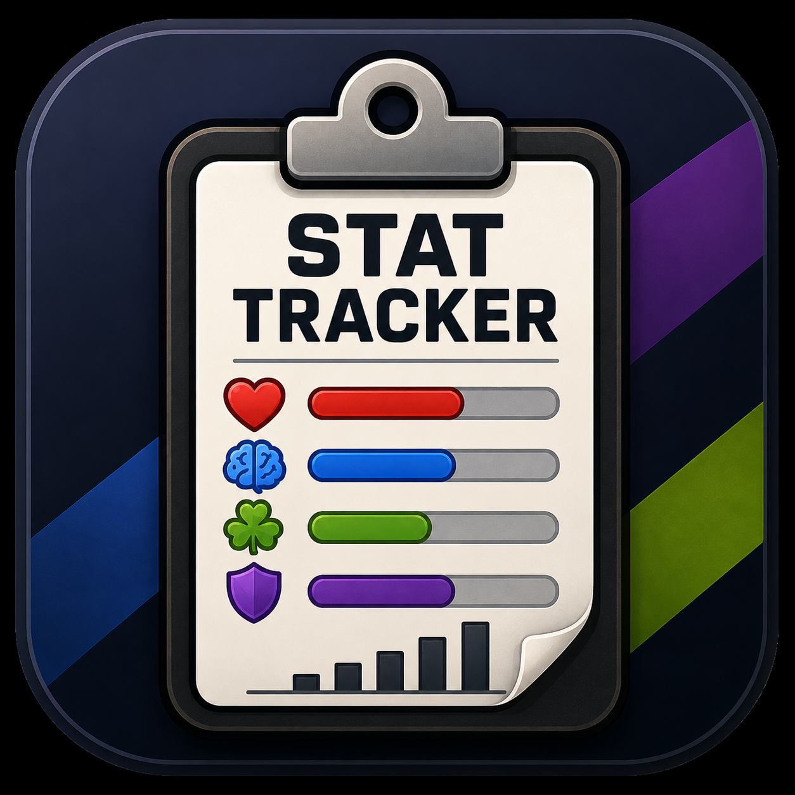

# Stat Tracker



**Stat Tracker** is a lightweight desktop application for tracking arbitrary numeric stats across multiple players, characters, entities, or targets.

It was originally designed with tabletop RPGs in mind, but the counters are intentionally generic. Use it for HP, sanity, spell slots, resources, victory points, conditions, or anything else that benefits from a simple shared grid.

## Features

- Customizable tracker title
- Add and remove players
- Add and remove counter columns
- Rename players
- Rename counters
- Independent values for every player
- Color-coded player groups
- Lock/unlock editing
- Reset all counters with confirmation
- Light and dark themes
- Automatic state persistence
- Legacy save migration
- Scrollable interface for larger trackers
- Windows installer support
- Automated tests

## Groups

Players can be assigned to color-coded groups for quick visual organization.

Available groups:

- None
- Green
- Orange
- Blue
- Purple
- Yellow
- Red
- Pink

Groups are intentionally generic and can represent teams, parties, factions, encounter groups, or any other organizational scheme.

## Editing and Lock Mode

Stat Tracker separates structural editing from normal tracker use.

When editing is unlocked, players, counter columns, names, groups, and other tracker configuration can be changed.

Once the tracker is configured, editing can be locked to reduce accidental structural changes during use.

## Persistence

Stat Tracker automatically saves its state between sessions.

Saved information includes:

- Tracker title
- Counter names
- Player names
- Player values
- Player groups
- Theme preference

Runtime tracker data is intentionally excluded from the Git repository so personal tracker state is not committed to source control.

## Running from Source

### Requirements

- Python 3.11+
- Tkinter
- pytest for running tests

Clone the repository:

    git clone https://github.com/Straconis/stat_tracker.git
    cd stat_tracker

Create and activate a virtual environment on Windows:

    python -m venv .venv
    .\.venv\Scripts\Activate.ps1

Run Stat Tracker:

    python .\app.py

## Testing

Run the automated test suite with:

    python -m pytest -q

The test suite covers persistence and application lifecycle behavior, including preservation of tracker state across close cycles and migration of existing tracker data.

## Project Structure

    stat_tracker/
    |-- app.py
    |-- models.py
    |-- persistence.py
    |-- theme.py
    |-- widgets.py
    |-- version.py
    |-- installer.iss
    |-- pytest.ini
    |-- stat_tracker.ico
    |-- stat_tracker.png
    `-- tests/
        |-- test_lifecycle.py
        `-- test_persistence.py

### Core Modules

**app.py**  
Main application and user-interface behavior.

**models.py**  
Application data models.

**persistence.py**  
Saving, loading, and migration behavior.

**theme.py**  
Theme and player-group color behavior.

**widgets.py**  
Custom user-interface widgets.

**version.py**  
Application name and version information.

## Linux builds

Stat Tracker runs natively on Linux with Python 3.11+ and Tkinter:

```bash
sudo apt-get install python3-tk python3-venv
python3 app.py
```

The UI includes the standard Straconis Software wordmark; clicking it or focusing it and pressing Return opens https://straconis.dev. Linux mouse wheels use Button-4 / Button-5 bindings alongside the existing MouseWheel handler.

Linux state lives in `$XDG_DATA_HOME/stat-tracker/tracker_data.json`, or `~/.local/share/stat-tracker/tracker_data.json`. Existing Windows-style Linux saves under `~/AppData/Local/Stat Tracker/` and development saves are copied on first launch when no new save exists. Windows keeps its original LOCALAPPDATA path. macOS uses `~/Library/Application Support/Stat Tracker/` (not packaged or manually tested here).

Create a standalone Linux x86_64 or aarch64 archive on that architecture:

```bash
python3 -m venv .venv
.venv/bin/pip install -r requirements-build.txt
.venv/bin/python -m pytest -q
PYTHON=.venv/bin/python ./scripts/package-linux.sh
```

The output is `dist/stat-tracker-linux-<architecture>.tar.gz` plus `dist/SHA256SUMS.txt`. Extract it and run `stat-tracker` from its directory. Keep `_internal/` beside the executable. No separate Python/Tkinter installation is required for the bundle; desktop system libraries are still required. `stat-tracker --smoke-test` constructs the UI, checks bundled images, and exits without saving tracker state; use an isolated XDG_DATA_HOME when testing.

The Linux workflow tests source and packaged UI startup under Xvfb and uploads CI artifacts. Builds use Ubuntu 22.04 for broader glibc compatibility. Tag runs attach the archive and checksum to an already-created GitHub release. A locally built archive inherits the build host's glibc requirements; the Debian 13 preview requires glibc 2.41. Build in CI for an older baseline. No new release is created automatically.

## Windows Builds

Stat Tracker can be packaged as a standalone Windows executable and distributed with the included Inno Setup installer script.

Include the PNG window icon and wordmark in Windows bundles too:

```powershell
python -m PyInstaller --onefile --windowed --name StatTracker --icon stat_tracker.ico --add-data "stat_tracker.png;." --add-data "assets/branding/straconis-software-wordmark.png;assets/branding" app.py
```


Generated build and distribution directories are intentionally excluded from source control.

## Version

Current version:

**Stat Tracker v1.0.0**

## Design Philosophy

Stat Tracker is intentionally simple and system-agnostic.

It does not assume what a counter represents or force a particular game system or workflow. Instead, it provides a flexible tracking grid and lets the user decide what the values mean.

The goal is to make tracking information during play quick enough that the tracker stays out of the way.

## Contributing

Bug reports, feature suggestions, and contributions are welcome.

If you encounter a problem, please open a GitHub issue with enough information to reproduce it.

## License

No license has been specified yet.
